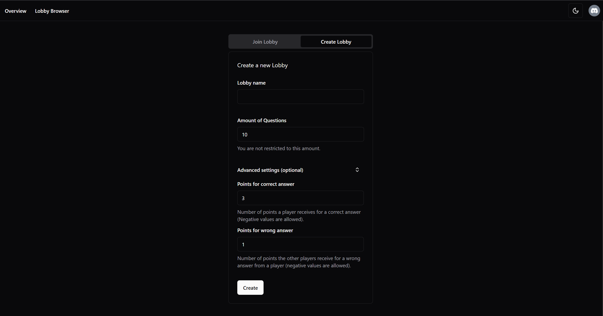
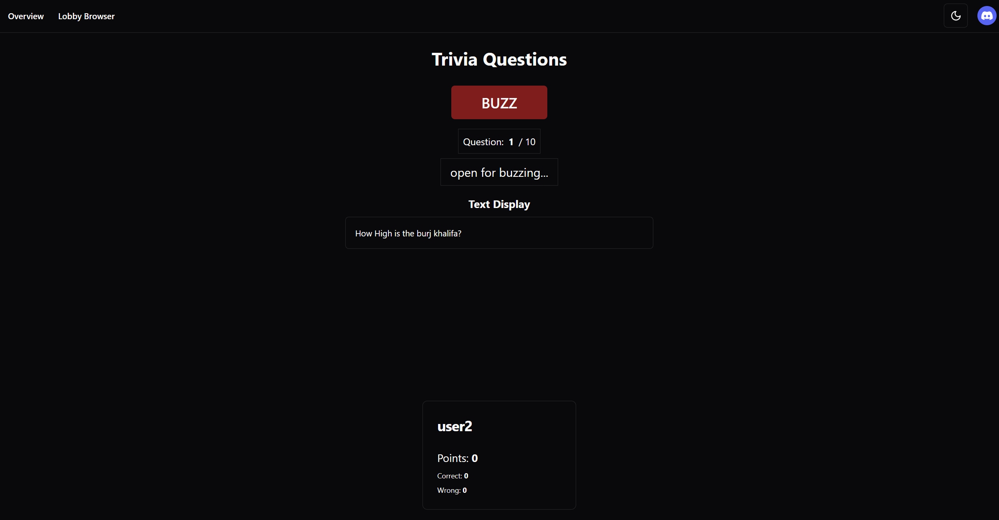
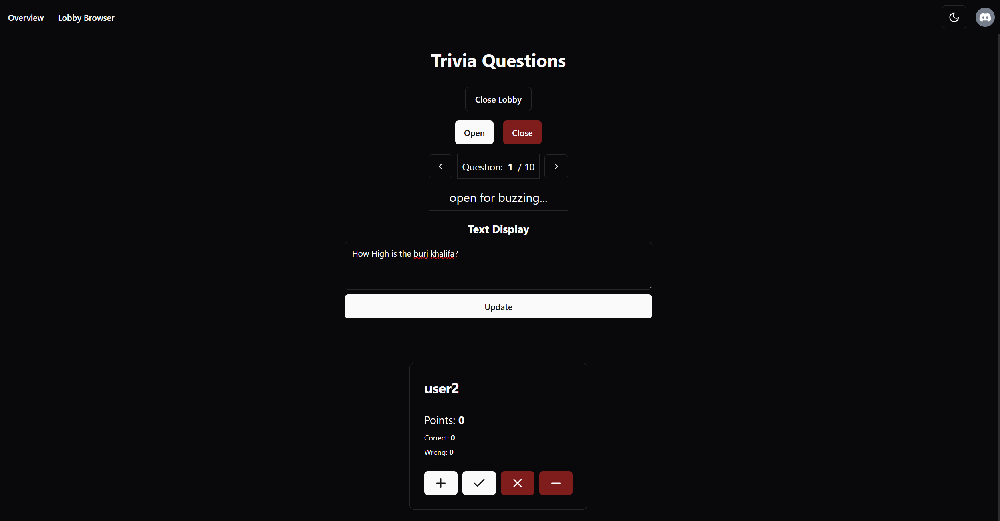
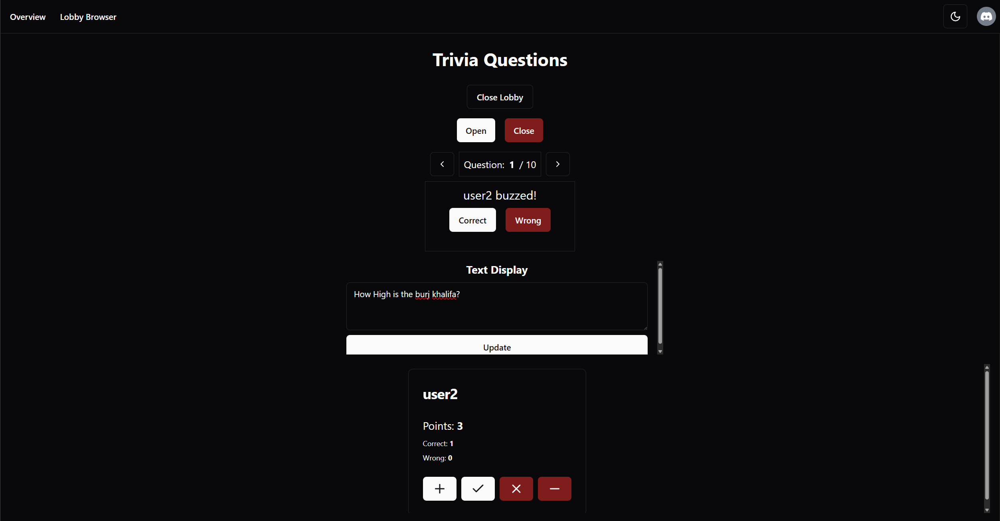
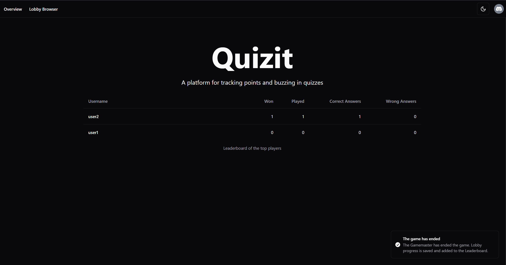

<div align="center">
  
  <h1>Quizit</h1>
  <p align="center">
    A self-hosted, real-time quiz platform for hosting lively game shows with friends, teams, or a room full of players.
    <br />
    Create a lobby, share its ID, open the buzzer, and keep score from one focused host view.
  </p>
  <p align="center">
    
    
    
    
    
  </p>
</div>

## What it does

Quizit keeps the logistics of a quiz night out of the way. The game master controls each question and scoring; players get a simple, responsive buzz button; everyone sees the same live state. When the game ends, player statistics are added to a persistent leaderboard.

### Highlights

- Real-time private lobbies with a clear game-master and player experience.
- First-to-buzz flow: opening the buzzer lets the first player claim it and closes it for everyone else.
- Configurable question count and scoring, including a score adjustment for the other players after a wrong answer.
- Host controls for question navigation, live question/display text, answer decisions, and manual point adjustments.
- Persistent player profiles and a top-player leaderboard with games played, wins, correct answers, and wrong answers.
- Discord authentication, PostgreSQL persistence, and a Pusher-compatible real-time server (Soketi) included in the Docker setup.

## Product tour

<p align="center">
  
  
</p>

<p align="center">
  
  
</p>

<p align="center">
  
</p>

## Quick start

### Prerequisites

- [Docker Desktop](https://www.docker.com/products/docker-desktop/) with Docker Compose.
- A Discord application with an OAuth2 client ID and client secret. Add this redirect URL in Discord: `http://localhost:3000/api/auth/callback/discord`.

### Run the complete stack

1. Create a local Compose file from the template.

   ```sh
   cp docker-compose.example.yml docker-compose.yml
   ```

   On PowerShell:

   ```powershell
   Copy-Item docker-compose.example.yml docker-compose.yml
   ```

2. In `docker-compose.yml`, replace the placeholder values for `NEXTAUTH_SECRET`, `DISCORD_CLIENT_ID`, and `DISCORD_CLIENT_SECRET`.

   Set the same app ID, key, and secret in both the `nextjs` service's `PUSHER_*` values and the `pusher` service's `SOKETI_DEFAULT_APP_*` values. `CLIENT_PUSHER_APP_HOST` must be reachable from browsers; `localhost` is correct for this local setup.

3. Start Quizit.

   ```sh
   docker compose up --build
   ```

4. Open [http://localhost:3000](http://localhost:3000) and sign in with Discord.

The application waits for PostgreSQL, applies database migrations, and then starts automatically. Stop the stack with `docker compose down`; add `--volumes` only when you intentionally want to remove local database data.

## How a game flows

1. The game master creates a lobby and shares its lobby ID with players.
2. Players sign in with Discord and join that lobby.
3. The host writes or updates the visible question text, then opens buzzing.
4. The first player to press **BUZZ** is shown to the host. The host marks the answer correct or wrong, or adjusts scores manually.
5. The host advances through questions and ends the game. Ending saves each player's game, win, and answer statistics to the leaderboard; cancelling discards that lobby's progress.

## Configuration

For local development, copy `.env.example` to `.env` and fill in the values below. The Docker Compose setup passes these values directly in its compose file instead.

| Variable                                               | Purpose                                                                                                                   |
| ------------------------------------------------------ | ------------------------------------------------------------------------------------------------------------------------- |
| `DATABASE_URL`                                         | PostgreSQL connection URL. Use the `db` hostname inside the Compose network and `localhost` when running the app locally. |
| `NEXTAUTH_SECRET`                                      | A long random value used to sign sessions. Generate one with `openssl rand -base64 32`.                                   |
| `NEXTAUTH_URL`                                         | Public application URL, such as `http://localhost:3000`.                                                                  |
| `DISCORD_CLIENT_ID` / `DISCORD_CLIENT_SECRET`          | Discord OAuth credentials.                                                                                                |
| `PUSHER_APP_ID`, `PUSHER_APP_KEY`, `PUSHER_APP_SECRET` | Server-side Pusher-compatible credentials. They must match Soketi's `SOKETI_DEFAULT_APP_*` values.                        |
| `PUSHER_APP_HOST` / `PUSHER_APP_PORT`                  | Host and port Quizit uses to publish real-time events.                                                                    |
| `CLIENT_PUSHER_APP_HOST` / `CLIENT_PUSHER_APP_PORT`    | Host and port browsers use to subscribe to real-time events.                                                              |

## Development

### Run without containerizing the app

Start PostgreSQL and Soketi from the development template:

```sh
docker compose -f docker-compose.dev.example.yml up -d
```

Then install dependencies, create a local environment file, initialize the schema, and start Next.js:

```sh
yarn install
cp .env.example .env
yarn db:push
yarn dev
```

On PowerShell, use `Copy-Item .env.example .env` for the copy step. The development server is available at [http://localhost:3000](http://localhost:3000).

### Useful commands

| Command                     | Description                                                  |
| --------------------------- | ------------------------------------------------------------ |
| `yarn dev`                  | Start the Next.js development server.                        |
| `yarn build`                | Create a production build.                                   |
| `yarn start`                | Serve a production build.                                    |
| `yarn lint`                 | Run the Next.js linter.                                      |
| `yarn db:push`              | Synchronize the Drizzle schema with the configured database. |
| `yarn db:studio`            | Open Drizzle Studio.                                         |
| `docker compose up --build` | Build and run the full application stack.                    |

## Tech stack

| Area           | Technologies                                                |
| -------------- | ----------------------------------------------------------- |
| App            | Next.js 14, React 18, TypeScript                            |
| UI             | Tailwind CSS, shadcn/ui, Radix UI, Lucide icons             |
| API            | tRPC, TanStack Query, Zod                                   |
| Authentication | NextAuth with Discord OAuth                                 |
| Data           | PostgreSQL and Drizzle ORM                                  |
| Real-time      | Pusher protocol with Soketi                                 |
| Delivery       | Docker, Docker Compose, and a non-root production container |

## Project structure

```text
src/app/           Next.js App Router pages and the game interface
src/server/game/   Lobby, game-master, and player game rules
src/server/api/    Type-safe tRPC API and authorization procedures
src/server/db/     Drizzle schema and PostgreSQL access
src/server/pusher/ Real-time event publishing and client subscriptions
drizzle/           Database migrations and migration runner
```

## Deployment note

Player accounts and leaderboard statistics are persisted in PostgreSQL. Active lobbies, however, currently live in the application's memory. Restarting or redeploying the app ends active games, and running multiple app instances is not supported without moving lobby state to shared storage.

## License

Quizit is available under the [MIT License](LICENSE).
